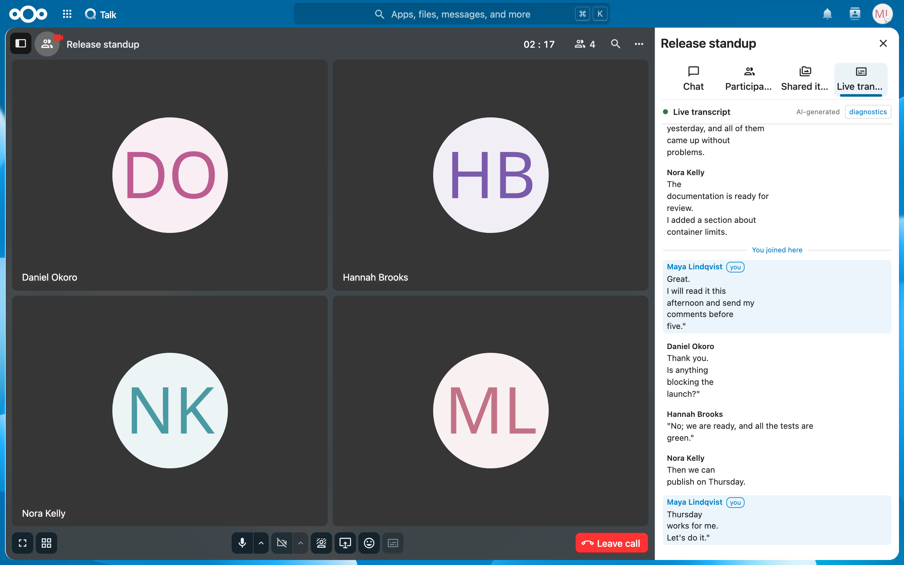

# Cassini Live

Cassini Live adds live captions to Nextcloud Talk calls. Open the **Live transcript** tab to follow each speaker by name, including yourself. Speech recognition runs on your server, on the CPU.

**Joining late?** Scroll above “You joined here” to read recent lines from the current call. Cassini Live keeps a bounded history in memory and clears it when the call’s caption session ends. It processes the call’s available audio tracks and writes neither audio nor transcripts to disk. [Privacy details](docs/privacy.md)

## Getting captions on Nextcloud 33, 34 and 35

Cassini Live declares support for all three versions. On each, Talk’s **Show captions** button calls Nextcloud’s own `live_transcription` app. To use Cassini Live under its own app ID, signed-in participants start captions with a bookmarklet. Guests cannot open the panel. The project has verified captions in a Nextcloud 34 browser call. Test coverage across all three versions is incomplete. [App manifest](appinfo/info.xml) · [Verification](docs/verification.md) · [Known limitations](docs/known-limitations.md)

1. **Once per browser**, open **Cassini Live** in Nextcloud’s app menu. Drag **Live transcript** to the bookmarks bar. On a phone or tablet, use the page’s copy option and paste the address into a bookmark.
2. **In a Talk call**, click the bookmark. It opens the transcript in Talk’s right sidebar and starts captions for you.

**When can users skip the bookmarklet?**

- **For live captions**, the Talk team’s open PR would let an administrator set `live_transcription_app_id` to `cassini_live`. Participants could then click **Show captions** in Talk. As of 19 November 2026, the PR carries the **Next Patch (35)** milestone. A Nextcloud 36 harness is testing the proposed change. End-to-end confirmation and a release date are pending. [Provider request](https://github.com/nextcloud/spreed/issues/20296) · [Talk’s implementation PR](https://github.com/nextcloud/spreed/pull/20369)
- **For scrollable history**, the bookmarklet opens Cassini Live’s sidebar today. We’ve separately proposed a native Talk sidebar so participants could also catch up there. [Talk transcript history proposal](https://github.com/nextcloud/spreed/issues/20400)

## Deploying Cassini Live

Install the `cassini_live` external app from a checkout while the first App Store release is in preparation. [Installation guide](docs/install.md#from-a-checkout) · [App Store release status](docs/appstore-checklist.md)

| What to check | What your installation needs or provides |
| --- | --- |
| Talk connection | Working calls through Talk’s High-performance backend (HPB), its internal secret, and AppAPI with a Docker deploy daemon. |
| Host limits | Linux with cgroup v2, enforced CPU, memory and process limits, and container swap disabled. Set the limits before loading an engine. |
| Speech recognition | Whistle is bundled and runs offline. Allow about 2 GiB of container memory. It captions English, German, French, Spanish, Italian, Dutch and Polish in the spoken language. |
| Engine choice | Administrators select one engine for the server. Optional Nemotron English and Nemotron Multilingual models download on demand and need at least 2.25 GiB of container memory. [Engine comparison](docs/install.md#choose-a-speech-engine) |
| Operations | Administrators can measure simultaneous-speaker capacity and inspect caption lag and resource use during a call. [Capacity](docs/capacity.md) · [Live diagnostics](docs/diagnostics-page.md) |

## Architecture at a glance

~~~mermaid
flowchart LR
    Panel["Talk transcript sidebar"] -->|Start via AppAPI| Proxy["Temporary Talk proxy"]
    Proxy -->|HTTP| API["Native caption provider API"]
    API -->|Join call| Room["Room manager and HPB client"]
    Room -->|WebRTC audio per speaker| VAD["Silero speech detection"]
    VAD -->|Speech segments| Engine["Whistle or Nemotron"]
    Engine -->|Caption text| HPB["Talk HPB"]
    HPB -->|Live captions| Panel
    History["Call history in memory"] -->|Catch up via AppAPI| Panel
~~~

| Follow the code | Entry points |
| --- | --- |
| Start a caption session | The temporary proxy verifies the user’s call session, then sends the same HTTP start or stop request Talk would send to the native provider API. The room manager owns the signalling connection and subscriptions. [Proxy](cassini_live/mock_talk_proxy.py) · [API](cassini_live/app.py) · [Room manager](cassini_live/service.py) |
| Turn speech into text | The Talk client receives one audio track per speaker. The transcriber gates speech and feeds bounded audio queues to a pool of Whistle worker processes or one shared Nemotron process with a stream per speaker. [Talk transport](cassini_live/talk/) · [Transcriber](cassini_live/transcriber.py) · [Whistle pool](cassini_live/pool.py) · [Nemotron host](cassini_live/engine_host.py) |
| Render the transcript | The sidebar merges live HPB messages with finalized lines from the history endpoint. Shared sequence numbers let it fill gaps and catch up late joiners without duplicating lines. [Panel code](ui/src/) · [UI design and tests](ui/README.md) |

[Architecture details](docs/architecture.md) · [Load and recovery](docs/capacity.md)

## Development

With Python 3.12 and uv, run the backend checks from the repository root:

~~~sh
uv sync --frozen
uv run python scripts/prepare_vad.py
uv run pytest -m 'not integration'
~~~

For recognition tests with real speech, run `uv run python scripts/prepare_model.py`, then `uv run pytest`. To exercise the full path in a Talk browser call, use the [development harness](docs/dev-harness.md). To inspect panel output from a recorded meeting, use the [replay viewer](docs/replay.md).

This project is substantially AI-assisted. [Verification record](docs/verification.md) · [Changelog](CHANGELOG.md) · [Release guide](docs/release.md) · [Third-party notices](NOTICE.md) · [AGPL-3.0-or-later](LICENSE)
