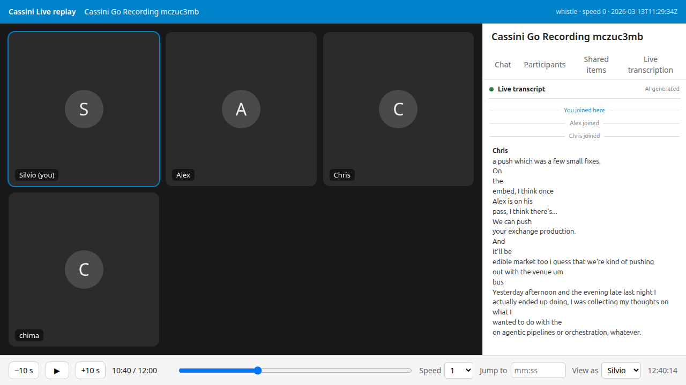

# Replaying an archived meeting through Cassini Live

Cassini (the recorder) archives every meeting as an `.mkv` with one audio track
per participant. Cassini Live can play those tracks through its own caption
pipeline and then show, in the transcript panel, what a participant would have
seen at any moment of that meeting. Two steps, two tools:

1. `python -m cassini_live.replay` turns a recording into a **replay
   timeline**: every join, final and partial, stamped with the meeting time at
   which it would have reached the browser.
2. `npm run replay` (in `ui/`) serves that timeline to the **real panel bundle**
   on a Talk-shaped page with a transport bar: play, pause, scrub, speed, and
   "view as" any participant.

Nothing here touches Nextcloud, Talk or the HPB. The recording never leaves the
machine.

## 1. Make the timeline

```sh
uv run python -m cassini_live.replay ~/cassini-recordings/daily-meeting-2026-03-13--12:29.mkv --list
uv run python -m cassini_live.replay ~/cassini-recordings/daily-meeting-2026-03-13--12:29.mkv \
    --from 10:00 --to 12:00 --engine whistle -o standup-whistle.json
uv run python -m cassini_live.replay ~/cassini-recordings/daily-meeting-2026-03-13--12:29.mkv \
    --from 10:00 --to 12:00 --engine nemotron-multilingual -o standup-nemotron.json
```

What it does: each participant track is decoded with PyAV and handed to the
same transcriber objects a Talk call feeds (`WhistleTranscriber` or
`StreamTranscriber`), behind the real Silero gate, the real worker pool or
engine host, and the real load governor defaults. The tracks advance in
lockstep on one shared meeting clock, so overlapping speakers contend for
workers exactly as they would in the call. A participant's first audio frame
is their join.

Options that matter:

- `--speed 1` paces the audio at real time. Worker contention, the four-second
  chunk expiry, dropped chunks and shedding then happen as in a call, and each
  event carries `wallMs`, the real latency behind it. Two minutes of meeting
  take two minutes.
- `--speed 0` (default) advances the clock only when the engine has answered
  everything fed so far: an engine of infinite speed. The text is what the
  engine makes of all the audio, and every event's `at` is the moment its
  speech chunk closed. Right for the UI and for comparing engines; wrong for
  latency. A two-minute window with four tracks takes about 30 s with Whistle.
- `--cpus 4` sizes the engine as production does for that quota (seats,
  threads). Use `--cpus 2` for staging's shape, or `--workers` to override.
- `--from MM:SS --to MM:SS` replays a window. Participants already in the call
  are dated as joining at the window start.
- `--only <participant>` restricts to some tracks (repeatable).

Engines: Whistle needs `models/whistle.cact` and `models/libneedle3.so`
(`scripts/prepare_model.py`); Nemotron needs its model directory under
`local/stt-eval/models/` or `--model-dir`. The VAD model comes from
`scripts/prepare_vad.py`.

### The timeline file

```json
{
  "format": "cassini-live-replay/1",
  "source": { "path": "…mkv", "title": "Cassini Go Recording mczuc3mb", "sessionId": "…", "startedAt": "2026-03-13T11:29:34Z" },
  "window": { "fromMs": 600000, "toMs": 720000 },
  "engine": { "id": "whistle", "seats": 2, "language": "en", "speed": 0 },
  "participants": [ { "sid": "silviot", "name": "Silvio", "userId": "silviot", "joinMs": 200 }, … ],
  "events": [
    { "at": 600000, "type": "join", "speakerSessionId": "silviot" },
    { "at": 605300, "type": "partial", "speakerSessionId": "Chris", "message": "a push", "langId": "en" },
    { "at": 605300, "type": "final", "speakerSessionId": "Chris", "message": "a push which was a few small fixes.", "langId": "en" },
    …
  ],
  "stats": { "finals": 72, "partials": 102, "elapsedS": 31.6, "framesDelivered": { … }, "backend": { …/status counters… } }
}
```

`at` is meeting time in milliseconds. `speakerSessionId` is the recorder's
participant id, standing in for the Talk session id. `startedAt` comes from the
recorder's `session_started_at` tag or the stamp in `SESSION_ID`; it is `null`
for recordings that carry neither, never the epoch. The timeline is plain data:
diff two of them to compare engines, or feed one to the viewer.

## 2. Watch it

```sh
cd ui && npm ci && npm run build
npm run replay -- ../standup-whistle.json           # open http://127.0.0.1:4318/call/replay
npm run replay -- ../standup-whistle.json --as Chris --port 4319
```

The page has Nextcloud's CSP posture and the sidebar structure the panel
mounts into, so the bundle on screen is the one the ExApp serves, mounted the
way the loader bookmarklet mounts it. The server owns the meeting clock:

- The panel's own `/history` poll gets exactly the joins and finals that
  existed at the current replay time, so catching up after a seek is the same
  code path as a late joiner's catch-up in a real call.
- The page feeds the panel the partial each speaker had in progress at that
  moment, through the panel's public `injectPartial`, and clears it when the
  final lands.
- A seek remounts the panel (its store is append-only by `seq`, like a live
  call's); playing just lets it poll. Speeds up to 16×. Space, ← and → work.
- "View as" reloads the page as another participant: their lines get the
  `you` chip and their join reads "You joined here". `?t=mm:ss` in the URL
  opens at that time.



## What it is for

- **UI work without a call.** Load a two-minute window and look at how the
  panel copes with one-word finals, a speaker who never stops, three people
  overlapping, or a long silence. Change the panel, `npm run build`, reload.
- **Pipeline work with the UI in the loop.** Run the same window through
  Whistle and Nemotron and scrub both. The Whistle timeline of the 2026-03-13
  standup shows the cost of its one-second commits: "On", "the", "embed, I
  think once" as separate lines where Nemotron gives one sentence.
- **Latency.** At `--speed 1`, `wallMs − at` of a final against the end of its
  speech is what a participant waited.

## What it is not

- Not WebRTC, not Opus over the network, not the HPB: `docs/verification.md`
  still wants a real Talk call for those.
- At speed 0 the engine never falls behind, so nothing is shed or dropped.
  Use speed 1 to see the governor act.
- Speaker names come from the recorder's tags, not from Talk's roster, so the
  prefix-matching of session ids that the live panel does is not exercised
  here; `ui/tests/panel.spec.js` covers that.
- The recorder's tracks start at each participant's first packet, which is the
  best available stand-in for "joined the call".
